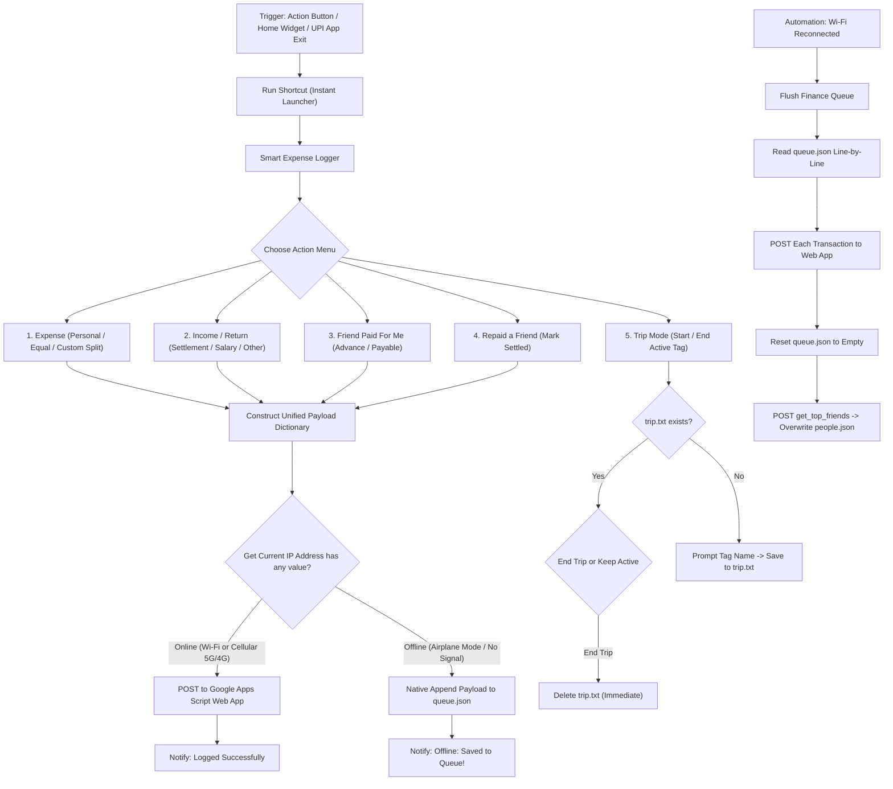

# iOS Shortcuts Technical Master Reference

## Overview
This document details the complete architecture, action-by-action pipelines, dictionary schemas, variable mappings, and background automations for the Apple Shortcuts suite designed for iPhone (iOS 18+).

All three shortcuts in this suite are preserved as native binary `.shortcut` files and parsed `.plist` files in [`docs/reference/`](./docs/reference/) so the entire system can be audited, reproduced, or imported directly without relying on temporary share links.

---

## 1. Modular Shortcut Suite Architecture

The system is decomposed into three specialized shortcuts to guarantee zero-latency launches, comprehensive transaction recording, and self-healing offline synchronization:

| Shortcut Name | Type | Local Reference Files | Core Responsibility |
| :--- | :--- | :--- | :--- |
| **Run Shortcut** | Fast Launcher | [`Run_Shortcut.shortcut`](./reference/Run_Shortcut.shortcut)<br>[`Run_Shortcut.plist`](./reference/Run_Shortcut.plist) | Assigned to Action Button or Home Widget. Decoupled entrypoint that immediately invokes `Smart Expense Logger`. Displays the menu in under 0.15s by eliminating startup file reads. |
| **Smart Expense Logger** | Core Engine | [`Smart_Expense_Logger.shortcut`](./reference/Smart_Expense_Logger.shortcut)<br>[`Smart_Expense_Logger.plist`](./reference/Smart_Expense_Logger.plist) | Comprehensive dispatcher for Expenses, Inflows, Payables, Repayments, and Trip Mode. Handles dynamic companion selection, debt linking, and native offline buffering. |
| **Flush Finance Queue** | Sync Runner | [`Flush_Finance_Queue.shortcut`](./reference/Flush_Finance_Queue.shortcut)<br>[`Flush_Finance_Queue.plist`](./reference/Flush_Finance_Queue.plist) | Background automation triggered on Wi-Fi reconnection. Iterates through buffered offline transactions, posts each to Google Sheets, clears the queue, and refreshes `people.json`. |

*Live iCloud installation links and capture dates are maintained in [`docs/SHORTCUT_LINKS.md`](./SHORTCUT_LINKS.md).*

---

## 2. System Flowchart



---

## 3. Shortcut 1: `Run Shortcut` (Fast Launcher)

### Purpose & Performance
* **Target Assignment:** Hardware **Action Button** (Settings → Action Button → Shortcut → `Run Shortcut`) or Home Screen 1-tap widget.
* **Architecture:** Decouples menu presentation from file system or network operations.
* **Latency:** <0.15 seconds to display the menu.

### Action Inventory (1 Action)
| Action Index | Identifier | Action Name | Configuration / Parameters |
| :--- | :--- | :--- | :--- |
| **Action 0** | `is.workflow.actions.runworkflow` | Run Shortcut | **Shortcut:** `Smart Expense Logger`<br>**Show While Running:** `True` |

---

## 4. Shortcut 2: `Smart Expense Logger` Action Pipeline

### Main Action Menu Dispatcher
* **Action 1:** `Choose from Menu` with prompt `"Choose Action"`.
  * Menu Options:
    1. `Expense`
    2. `Income/Return`
    3. `Friend Paid For Me`
    4. `Repaid a Friend`
    5. `Trip Mode (Start/End)`

---

### Branch 1: "Expense" Outflow (Actions 2 to 67)

1. **Trip Mode Detection & Amount Input (Actions 2–11):**
   * Action 2: `Get File from Shortcuts` (`FinanceAutomation/trip.txt`, Error If Not Found: OFF).
   * Action 3: **If `File` has any value:**
     * Action 4: `Set Variable` `TripTag` to `File`.
     * Action 5: `Ask for Number` with dynamic prompt `"Enter Amount ₹ ([TripTag]):"`.
   * Action 6: **Otherwise:**
     * Action 7: `Text` (empty string).
     * Action 8: `Set Variable` `TripTag` to `Text`.
     * Action 9: `Ask for Number` with prompt `"Enter Amount ₹:"`.
   * Action 10: **End If**.
   * Action 11: `Set Variable` `Amount` to `If Result`.
2. **Account Selection (Actions 12–14):**
   * Action 12: `List` (`SBI`, `Canara`, `Cash`, `Other`).
   * Action 13: `Choose from List` with prompt `"Select Account"`.
   * Action 14: `Set Variable` `Account` to `Chosen Item`.
3. **Item Description (Actions 15–16):**
   * Action 15: `Ask for Text` with prompt `"What was this for?"`.
   * Action 16: `Set Variable` `Item` to `Provided Input`.
4. **Category Selection (Actions 17–21):**
   * Action 17: `List` (`Food & Drink`, `Groceries`, `Transit`, `Subscriptions`, `Shopping`, `Trip/Travel`, `Health`, `Family`, `Saving`, `Other`).
   * Action 18: `Choose from List` with prompt `"Select Category"`.
   * Action 19: `Set Variable` `Category` to `Chosen Item`.
5. **Split Mode Selection (Actions 22–24):**
   * Action 22: `List` (`Just Me`, `Split Equally`, `Custom Split`).
   * Action 23: `Choose from List` with prompt `"Split Mode"`.
   * Action 24: `Set Variable` `SplitMode` to `Chosen Item`.
6. **Split Calculations & Dynamic Friend Extraction (Actions 25–64):**
   * **If `SplitMode` is `Just Me`:**
     * `Set Variable` `MyShare` = `Amount`.
     * `Set Variable` `OwedToMe` = `0`.
     * `Set Variable` `Companions` = `"Personal"`.
     * `Set Variable` `Status` = `"Personal"`.
   * **If `SplitMode` is `Split Equally` or `Custom Split`:**
     * **Step A (File Retrieval):** `Get File from Folder` (`Shortcuts/FinanceAutomation/people.json`).
     * **Step B (Extraction Loop):** `Get Dictionary Value` for key `people`. `Repeat with Each` item → extract key `name` from `Repeat Item`.
     * **Step C (Picker Construction):** `List` containing `Repeat Results` and `+ Add New`.
     * **Step D (Friend Selection):** `Choose from List` (Select Multiple enabled).
     * **Step E (New Friend Fallback):**
       * If selection contains `+ Add New`: `Ask for Text` with prompt `"Enter friend's Name:"` → `Set Variable` `Companions`.
       * Otherwise: `Combine Text` with separator `, ` → `Set Variable` `Companions`.
     * **Step F (Calculations):**
       * **If `Split Equally`:**
         * `Count Items` in selection → `Calculate: Add 1` (for Anuj) → Variable: `TotalHeads`.
         * `Calculate: Amount ÷ TotalHeads` → Variable: `MyShare`.
         * `Calculate: Amount - MyShare` → Variable: `OwedToMe`.
         * `Set Variable` `Status` = `"Pending"`.
       * **If `Custom Split`:**
         * `Ask for Number` with prompt `"Enter your share ₹:"` → Variable: `MyShare`.
         * `Calculate: Amount - MyShare` → Variable: `OwedToMe`.
         * `Set Variable` `Status` = `"Pending"`.
7. **Date Timestamp (Action 65):**
   * Action 65: `Date` formatted as short date and time → Variable: `TxnDate`.
8. **Payload Construction (Action 66):**
   * `Dictionary` containing:
     * `action`: `"log_debit"` (Text)
     * `token`: Secret token string (Text)
     * `date`: `TxnDate` (Text)
     * `account`: `Account` (Text)
     * `item`: `Item` (Text)
     * `category`: `Category` (Text)
     * `total_amount`: `Amount` (Number)
     * `my_share`: `MyShare` (Number)
     * `owed_to_me`: `OwedToMe` (Number)
     * `status`: `Status` (Text)
     * `companions`: `Companions` (Text)
     * `trip_tag`: `TripTag` (Text)
   * `Set Variable` `Payload` to `Dictionary`.
9. **UI Feedback (Action 67):**
   * `Show Notification`: `"Logged ₹[Amount] for [Item]!"`.

---

### Branch 2: "Income / Return" Inflow (Actions 68 to 103)

1. **Amount Input (Actions 69–70):** `Ask for Number` with prompt `"Amount Recieved ₹"` → Variable: `InflowAmount`.
2. **Account Selection (Actions 71–73):** `List` (`SBI`, `Canara`, `Cash`, `Other`) → `Choose from List` → Variable: `InflowAccount`.
3. **Inflow Type Selection (Actions 74–76):** `List` (`Friend Settlement`, `Salary/Stipend`, `Allowance`, `Other`) → `Choose from List` → Variable: `InflowType`.
4. **Sender Input (Actions 77–78):** `Ask for Text` with prompt `"Who sent this?"` → Variable: `RecievedFrom`.
5. **Interactive Settlement Check with Empty-Debt Guard (Actions 79–95):**
   * **If `InflowType` is `Friend Settlement`:**
     * `Dictionary`: `{"action": "get_pending_debts", "token": "...", "person": RecievedFrom}`.
     * `Get Contents of URL`: POST to Apps Script Web App.
     * `Get Dictionary Value` for key `pendingDebts`.
     * **Empty Debt Guard (`If [Dictionary Value] has any value`):**
       * `Choose from List` with prompt `"Select Bill to settle"`.
       * `Set Variable` `LinkedDebitRow` to selected item reference (e.g. `Nov26!Row20`).
     * **Otherwise:**
       * `Text` (empty string).
       * `Set Variable` `LinkedDebitRow` to `Text`.
     * **End If**
   * **Otherwise (Salary / Allowance / Other):**
     * `Text` (empty string).
     * `Set Variable` `LinkedDebitRow` to `Text`.
   * **End If**
6. **Reason Input (Actions 96–97):** `Ask for Text` with prompt `"Reason / Note"` → Variable: `InflowReason`.
7. **Date Timestamp (Actions 98–100):** Formatted date → Variable: `FormattedDate`.
8. **Payload Construction (Action 101):**
   * `Dictionary` containing:
     * `action`: `"log_credit"`
     * `token`: Secret token string
     * `date`: `FormattedDate`
     * `account`: `InflowAccount`
     * `amount`: `InflowAmount`
     * `inflow_type`: `InflowType`
     * `received_from`: `RecievedFrom`
     * `reason`: `InflowReason`
     * `linked_debit_row`: `LinkedDebitRow`
   * `Set Variable` `Payload` to `Dictionary`.
9. **UI Feedback (Action 102):** `Show Notification`: `"Recieved ₹[InflowAmount] from [RecievedFrom]"`.

---

### Branch 3: "Friend Paid For Me" Advance (Actions 104 to 116)

1. **Amount Input (Actions 105–106):** `Ask for Number` with prompt `"Amount I Owe ₹"` → Variable: `OweAmount`.
2. **Payer Input (Actions 107–108):** `Ask for Text` with prompt `"Who paid for you?"` → Variable: `PaidBy`.
3. **Reason Input (Actions 109–110):** `Ask for Text` with prompt `"What was this for?"` → Variable: `WhatFor`.
4. **Date Timestamp (Actions 111–113):** Formatted date → Variable: `FormattedDate`.
5. **Payload Construction (Action 114):**
   * `Dictionary` containing:
     * `action`: `"log_payable"`
     * `token`: Secret token string
     * `date`: `FormattedDate`
     * `paid_by`: `PaidBy`
     * `what_for`: `WhatFor`
     * `amount_owed`: `OweAmount` (Number)
   * `Set Variable` `Payload` to `Dictionary`.
6. **UI Feedback (Action 118):** `Show Notification`: `"You Owe [PaidBy] ₹[OweAmount]"`.

---

### Branch 4: "Repaid a Friend" Settlement (Actions 117 to 125)

1. **Friend Input (Actions 118–119):** `Ask for Text` with prompt `"Who did you repay?"` → Variable: `RepayPerson`.
2. **Date Timestamp (Actions 120–122):** Formatted date string → Variable: `RepayDate`.
3. **Payload Construction (Action 123):**
   * `Dictionary` containing:
     * `action`: `"log_repayment"`
     * `token`: Secret token string
     * `person`: `RepayPerson`
     * `date_repaid`: `RepayDate`
   * `Set Variable` `Payload` to `Dictionary`.
4. **UI Feedback (Action 125):** `Show Notification`: `"Marked repayment to [RepayPerson] as Repaid!"`.

---

### Branch 5: "Trip Mode (Start/End)" Active Toggle (Actions 126 to 139)

1. **File Check (Action 127):** `Get File from Shortcuts` (`FinanceAutomation/trip.txt`, Error If Not Found: OFF).
2. **Conditional Mode (Action 128):** `If [File] has any value`:
   * **Sub-Menu: Existing Trip Active:**
     * `Choose from Menu` with prompt `"What would you like to do? [File]"`.
     * **Option 1 (`End Trip`):** `Delete Files` (`Delete Immediately: ON`) → Notification: `"Trip Mode ended. Expenses are now untagged."`.
     * **Option 2 (`Keep Active`):** Empty branch (leaves file untouched).
3. **Otherwise (No Trip Active):**
   * `Ask for Text` with prompt `"Enter Trip Tag (e.g. Goa 2026):"`.
   * `Save File` (`Provided Input` to `FinanceAutomation/trip.txt`, Overwrite If File Exists: ON).
   * `Show Notification`: `"Trip Mode Started: [Provided Input]"`.
4. **End If (Action 138)**.

---

### Common Network Pipeline & Offline Failover (Actions 140 to 146)

All transaction branches converge at this single transmission gate:
1. **Network Check (Action 140):** `Get Current IP Address` (Type: `IPv4`, Address: `Local`).
2. **Condition Gate (Action 141):** `If Current IP Address has any value`:
   * **Online Path (Action 142):**
     * `Get Contents of URL`:
       * Method: `POST`
       * URL: `https://script.google.com/macros/s/YOUR_WEB_APP_URL/exec`
       * Headers: `Content-Type: application/json`
       * Request Body: `File` bound to `Payload` variable.
   * **Offline Path (Actions 143–145):**
     * `Otherwise`:
     * `Append to File`:
       * Input: `Payload` variable.
       * File Path: `queue.json` inside local folder `Shortcuts/FinanceAutomation`.
       * Make New Line: `True`.
     * `Show Notification`: `"Offline: Saved to Queue!"`.
3. **End If (Action 146)**.

---

## 5. Shortcut 3: `Flush Finance Queue` (Background Sync)

### Automation Setup
* **Trigger:** Shortcuts app → **Automations** tab → `+` → **Wi-Fi** → Network: `Any Network` → `Run Immediately` (Notify When Run: OFF).
* **Target:** `Flush Finance Queue`.

### Step-by-Step Action Inventory (15 Actions)

| Action Index | Identifier | Action Name | Configuration / Parameters |
| :--- | :--- | :--- | :--- |
| **Action 0** | `documentpicker.open` | Get File | Folder: `Shortcuts/FinanceAutomation`<br>File Path: `queue.json`<br>Error If Not Found: `False` |
| **Action 1** | `detect.text` | Get Text from Input | Input: `File` (from Action 0) |
| **Action 2** | `text.split` | Split Text | Text: `Text` (from Action 1)<br>Separator: `New Lines` |
| **Action 3** | `count` | Count | Input: `Split Text`<br>Type: `Items` |
| **Action 4** | `conditional` | If | Condition: `Count > 0` |
| **Action 5** | `repeat.each` | Repeat with Each | Input: `Split Text` |
| **Action 6** | `downloadurl` | Get Contents of URL | Method: `POST`<br>URL: Web App Endpoint<br>Headers: `Content-Type: application/json`<br>Body: `File` bound to `Repeat Item` |
| **Action 7** | `repeat.each` | End Repeat | Groups iterative line submissions |
| **Action 8** | `gettext` | Text | Empty text (`""`) |
| **Action 9** | `documentpicker.save` | Save File | Input: Empty text<br>Path: `queue.json`<br>Overwrite If File Exists: `True`<br>Ask Where to Save: `False` |
| **Action 10** | `notification` | Show Notification | Body: `"All offline expenses synced !"` |
| **Action 11** | `conditional` | End If | Closes Count > 0 block |
| **Action 12** | `dictionary` | Dictionary | `action`: `"get_top_friends"`<br>`token`: `"YOUR_SECRET_TOKEN"` |
| **Action 13** | `downloadurl` | Get Contents of URL | Method: `POST`<br>URL: Web App Endpoint<br>Headers: `Content-Type: application/json`<br>Body: `Dictionary` (from Action 12) |
| **Action 14** | `documentpicker.save` | Save File | Input: `Contents of URL` (JSON response)<br>Path: `people.json`<br>Overwrite If File Exists: `True`<br>Ask Where to Save: `False` |

---

## 6. Local Storage Schema Specifications

Both state files reside inside the native local folder: `On My iPhone/Shortcuts/FinanceAutomation/`.

### `people.json` (Companion List)
Supplies friend names to multi-select pickers in `Smart Expense Logger`. Overwritten dynamically by Action 14 of `Flush Finance Queue`:
```json
{
  "status": "success",
  "people": [
    { "name": "Raghav" },
    { "name": "Soham O" },
    { "name": "Rohit" },
    { "name": "Soham V" },
    { "name": "Shivam S" }
  ]
}
```

### `queue.json` (Offline Transaction Buffer)
Stores JSON payloads line-by-line while offline. Emptied after successful flush:
```json
{"action":"log_debit","token":"...","date":"02/11/2026, 04:30 PM","account":"SBI","item":"Chai","category":"Food & Drink","total_amount":20,"my_share":20,"owed_to_me":0,"status":"Personal","companions":"Personal","trip_tag":""}
{"action":"log_debit","token":"...","date":"02/11/2026, 07:15 PM","account":"Cash","item":"Dinner","category":"Food & Drink","total_amount":600,"my_share":200,"owed_to_me":400,"status":"Pending","companions":"Raghav, Rohit","trip_tag":"Pune"}
```

### `trip.txt` (Active Trip Tag)
Plain text file containing the current active trip tag string (e.g. `Pune Trip 2026`). Created when starting Trip Mode; deleted when ending Trip Mode.
